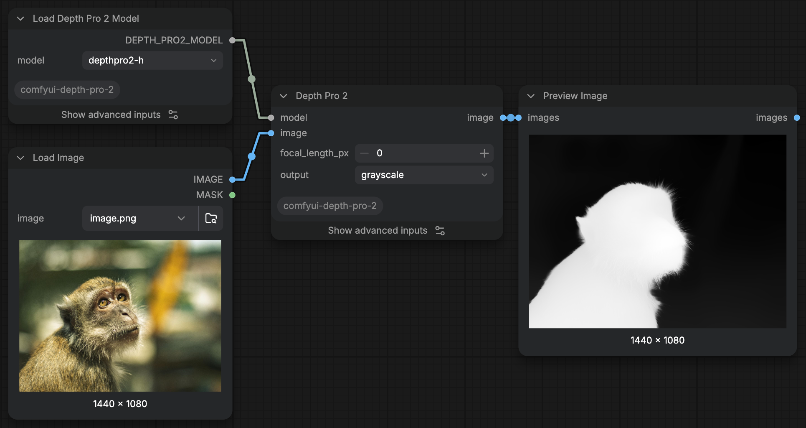

# ComfyUI Depth Pro 2

English | [简体中文](README_zh.md)

ComfyUI node for [Apple Depth Pro 2](https://github.com/apple-aiml-research/ml-depth-pro-2):
sharp metric monocular depth from a single photo, at full resolution. Takes an `IMAGE`, returns a
depth map as `IMAGE` (inverse depth normalized per frame, white near / black far).

Project page, with the paper, the comparison videos and the benchmarks:
[apple-aiml-research.github.io/ml-depth-pro-2](https://apple-aiml-research.github.io/ml-depth-pro-2/).
Upstream: [paper](https://arxiv.org/abs/2611.26603) ·
[code](https://github.com/apple-aiml-research/ml-depth-pro-2) ·
[weights](https://huggingface.co/apple/DepthPro2).



## Install

```bash
cd ComfyUI/custom_nodes
git clone https://github.com/yanhuifair/comfyui-depth-pro-2
pip install -r comfyui-depth-pro-2/requirements.txt
```

Run the `pip` line in the Python environment that runs ComfyUI.
`timm`, `huggingface-hub` and `certifi` are the only additions; `torch`, `numpy`, `Pillow` and `av`
already come with ComfyUI. `timm` is held below 1.1 because the vendored model code uses the
timm 1.0 vision-transformer API. Restart ComfyUI and the node shows up as **Depth Pro 2** in the
`depth` category. Any ComfyUI release with V3 node support (`comfy_entrypoint`) works; tested on
0.45.4.

## Models

| Preset | File | Size | Notes |
| --- | --- | --- | --- |
| `depthpro2-s` | `depthpro2-s-bgcc6f8bg3.pt` | 97 MB | fastest |
| `depthpro2-b` | `depthpro2-b-xb7m9egktw.pt` | 386 MB | |
| `depthpro2-l` | `depthpro2-l-tegstu7fim.pt` | 1.3 GB | |
| `depthpro2-h` | `depthpro2-h-eivtm5w7m5.pt` | 3.5 GB | default, sharpest |
| FOV head | `depthpro2-fov-ew55zg4kq7.pt` | 94 MB | shared by every preset |

Checkpoints are downloaded on first use of the node, into `models/depth_pro2/`. That folder is
registered as `depth_pro2` in `folder_paths`, so extra search paths from `extra_model_paths.yaml`
are used for both lookup and download.

## Inputs

| Input | Default | Description |
| --- | --- | --- |
| `image` | — | `IMAGE` batch, predicted one frame at a time. |
| `model` | `depthpro2-h` | Preset, see above. |
| `focal_length_px` | `0` | Focal length in pixels. `0` estimates it with the field-of-view network. |
| `max_side` | `0` | Downscale the longest side to this many pixels before inference; `0` keeps full resolution. Advanced. |
| `precision` | `auto` | Autocast dtype: `auto` is bfloat16 on GPU and float32 on CPU. Use `fp16` on GPUs without bfloat16. Advanced. |
| `output` | `grayscale` | `grayscale`: inverse depth, white near. `color`: depth ramp, red near, blue far. |

## Notes

- The output is a normalized visualization map, not metric depth in meters. See the upstream repo
  if you need raw metric depth.
- Output resolution is the inference resolution: the input size, or the `max_side`-reduced size.
- Frames are predicted one at a time, each with its own focal length. The temporally consistent
  video results on the project page come from upstream's multi-view path, so a batch here has no
  consistency between frames.
- The field-of-view head is loaded for every preset, even when `focal_length_px` is supplied.
- Out of memory: lower `max_side`. A supplied focal length is scaled by the same factor.

## Troubleshooting

| Symptom | Cause |
| --- | --- |
| `SSLCertVerificationError` while downloading | The node downloads through `certifi`, because python.org macOS builds ship an empty CA bundle. If it still fails, run `Install Certificates.command` in that Python's folder. |
| Depth scale or geometry looks wrong | `focal_length_px` is a guess when left at `0`; pass the real focal length in pixels. |

## Files

```
nodes.py             node definition, checkpoint lookup and download
vendor/depth_pro_2/  Apple's inference code, see vendor/LICENSE
examples/            screenshot above
```

## License

The node code is MIT, see [LICENSE](LICENSE). The vendored `depth_pro_2` sources are Apple's, under
`vendor/LICENSE`. The model weights are
[research-use only](https://github.com/apple-aiml-research/ml-depth-pro-2/blob/main/LICENSE_MODEL).
Check both before shipping anything made with them.
