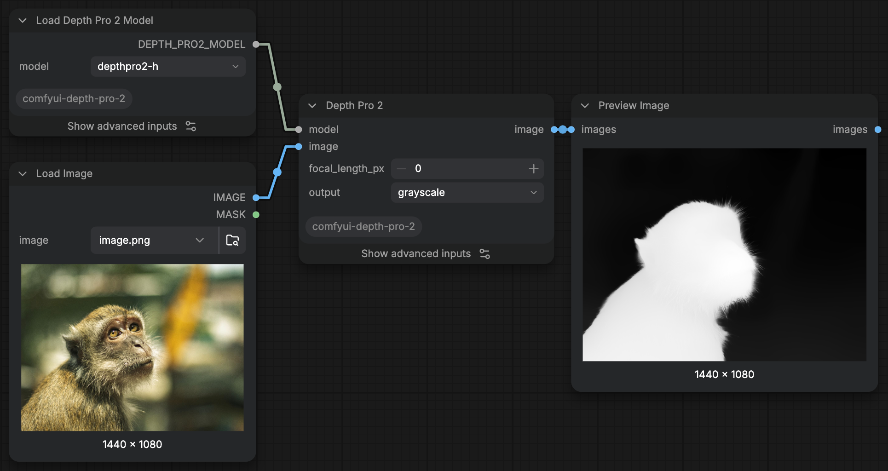

# ComfyUI Depth Pro 2

[English](README.md) | 简体中文

[Apple Depth Pro 2](https://github.com/apple-aiml-research/ml-depth-pro-2) 的 ComfyUI 节点：
单张照片估出边缘锐利的度量深度，全分辨率推理。深度节点输入 `IMAGE`，输出同样为 `IMAGE` 的深度图
（逆深度，按帧归一化，白近黑远）。

项目主页有论文、对比视频和评测结果：
[apple-aiml-research.github.io/ml-depth-pro-2](https://apple-aiml-research.github.io/ml-depth-pro-2/)。
上游链接：[论文](https://arxiv.org/abs/2611.26603) ·
[代码](https://github.com/apple-aiml-research/ml-depth-pro-2) ·
[权重](https://huggingface.co/apple/DepthPro2) ·
[Core ML 权重](https://huggingface.co/apple/DepthPro2-coreml)。



## 安装

```bash
cd ComfyUI/custom_nodes
git clone https://github.com/yanhuifair/comfyui-depth-pro-2
pip install -r comfyui-depth-pro-2/requirements.txt
```

`pip` 那行要在运行 ComfyUI 的那个 Python 环境里执行。
只新增 `timm`、`huggingface-hub`、`safetensors`、`certifi`，以及在 macOS 上为可选的
[Core ML 后端](#core-mlapple-芯片)准备的 `pyobjc-framework-CoreML`；`torch`、`numpy`、`Pillow`、`av` 由 ComfyUI 本体
提供。`timm` 上限锁在 1.1 以下，因为 vendored 模型代码用的是 timm 1.0 的 vision-transformer 接口。
重启 ComfyUI 后，`model/loaders` 分类下是 **Load Depth Pro 2 Model**，`depth` 分类下是
**Depth Pro 2**。需要支持 V3 节点（`comfy_entrypoint`）的 ComfyUI 版本，实测 0.45.4。

## 用法

把 **Load Depth Pro 2 Model** 的输出连到 **Depth Pro 2** 的 `model` 口，图片接入 `image`，深度图
再接给任意图片节点（保存、ControlNet、转遮罩……）。一个加载器可以同时喂多个深度节点；权重会留在
ComfyUI 的节点缓存里，直到被缓存回收。

## 焦距

焦距模型和深度模型一样，有独立的加载器节点：

- **Load Depth Pro 2 Focal Model** → **Depth Pro 2 Focal**：用 PyTorch 跑 Apple 独立的
  [DepthPro2-focal](https://huggingface.co/apple/DepthPro2-focal) 权重，89 MB 权重首次使用时下载到
  `models/depth_pro2/`。
- **Load Depth Pro 2 Focal Core ML** → **Depth Pro 2 Focal (Core ML)**：用 Apple Core ML 深度包同仓库里的
  视场角包。

两个估焦距节点都只吃 `IMAGE`，逐帧推理后返回批次中位数（以像素为单位的 `FLOAT`），可以接到深度节点的
`focal_length_px` 输入口，也能拿这个数做自己的标定。加载好的模型会像深度加载器一样缓存复用。

## 视频

**Depth Pro 2 Video** 输入 `VIDEO`、输出 `VIDEO`，配 ComfyUI 自带节点就够：**Load Video** →
**Depth Pro 2 Video** → **Save Video**。帧率和音轨沿用源视频，另外还输出 `images`，方便只要帧序列的场合。

它和把帧一帧丢给拍照节点的区别在于：一次联合推理 `window` 帧，相邻帧互相注意到，深度图不再乱爬。
用 `depthpro2-s` 跑一段 12 帧、512×512 的测试片段，按相邻归一化深度图的平均绝对差衡量：

| 推理方式 | 帧间变化 |
| --- | --- |
| 逐帧独立 | 0.056 |
| unbuffered，window 4 | 0.052 |
| buffered，window 4，overlap 2 | 0.044 |
| buffered，window 16，overlap 4（默认） | 0.030 |

显存随 `window` 增长：一次要过 `window` 帧的网络，所以这个节点的 `max_side` 默认是 1024，而不是全分辨率。
做个参考：Apple 芯片上跑 `depthpro2-h`、16 帧 1024×768、默认窗口，耗时 6 s、占 3.7 GB。

算力取决于片段步长而不是帧数：window 16 / overlap 4 每趟前进 12 帧，每帧大约算 1.3 遍；window 4 /
overlap 3 每趟只前进 1 帧，每帧要算 4 遍——同一段素材上前者 6 s、后者 23 s。

## 模型

| 预设 | 文件 | 体积 | 说明 |
| --- | --- | --- | --- |
| `depthpro2-s` | `depthpro2-s-bgcc6f8bg3.pt` | 97 MB | 最快 |
| `depthpro2-b` | `depthpro2-b-xb7m9egktw.pt` | 386 MB | |
| `depthpro2-l` | `depthpro2-l-tegstu7fim.pt` | 1.3 GB | |
| `depthpro2-h` | `depthpro2-h-eivtm5w7m5.pt` | 3.5 GB | 默认，最锐利 |
| FOV 头 | `depthpro2-fov-ew55zg4kq7.pt` | 94 MB | 各预设共用 |
| Focal 头 | `depthpro2-focal.safetensors` | 89 MB | 独立，供 Depth Pro 2 Focal 使用 |

权重在加载器节点首次运行时下载到 `models/depth_pro2/`。该目录已按 `depth_pro2` 注册进 `folder_paths`，
因此 `extra_model_paths.yaml` 里的额外搜索路径对查找和下载都生效。

## Core ML（Apple 芯片）

两个加载器都输出同样的 `DEPTH_PRO2_MODEL`，后面的节点不用改。要求 Apple 芯片 + macOS 15 及以上，
Python 侧的桥接层已写进 `requirements.txt`；Apple 官方包已在本机 macOS 27 上用公开 Core ML API 验证。

**Load Apple Depth Pro 2 Core ML** 首次使用时从
[`apple/DepthPro2-coreml`](https://huggingface.co/apple/DepthPro2-coreml/) 下载官方包到
`models/depth_pro2/`，再加载包里的某个 `res_<W>x<H>` 函数。

| 包 | 体积 | 说明 |
| --- | --- | --- |
| `depthpro2-s_w4.mlpackage` | 51 MB | 最快 |
| `depthpro2-b_w4.mlpackage` | 188 MB | |
| `depthpro2-l_w4.mlpackage` | 891 MB | |
| `depthpro2-h_w4.mlpackage` | 1.6 GB | 最锐利 |
| `depthpro2-fov_512x896.mlpackage` | 91 MB | 焦距，给 Core ML 焦距节点用 |

深度包提供 `res_854x480`（默认）、`res_640x360`、`res_896x512`、`res_1138x640`、`res_1280x720`
五个函数；用 `resolution` 选择，深度图就按对应尺寸输出。`w4` 包在 Core ML state 里保留四帧：拍照节点
每张图重置一次状态，**Depth Pro 2 Video** 则整段共用一份状态。`window`、`overlap`、`mode` 对 Core ML
无效。显存随尺寸涨得很快：S 在 854x480 约 1.5 GB、1280x720 约 5 GB；L 分别约 4 GB 和 18 GB。
16 GB 的 Mac 建议用 S 或 B，并保持默认尺寸。

**Load Depth Pro 2 Focal Core ML** 把同一个仓库里的视场角包加载成 `DEPTH_PRO2_FOCAL_COREML_MODEL`，
**Depth Pro 2 Focal (Core ML)** 再把每帧放大裁剪到 896x512，估出以像素为单位的焦距，返回批次中位数。

**Load Depth Pro 2 Core ML** 列出 `models/depth_pro2/` 里已有的 `.mlpackage`，包括下载好的官方包和自己
导出的包。想导出别的尺寸，coremltools 在 Python 3.13 之后没有 wheel，所以导出得用旧解释器——`uv`
可以现拉一个，ComfyUI 自己该用哪个 Python 还用哪个：

```bash
cd ComfyUI/custom_nodes/comfyui-depth-pro-2
uv run --python 3.13 --with coremltools --with timm --with av \
    python tools/export_coreml.py --preset depthpro2-s --size 854x480 \
    --output ../../models/depth_pro2/depthpro2-s_854x480.mlpackage
```

导出约两分钟，包体积约为 `.pt` 的一半。放进目录后按 `r` 刷新节点列表，加载器里就能选到它。想要别的
分辨率就再换一个 `--size` 导一次。自己导的包只有一个尺寸、无时序状态；所有 Core ML 包都忽略 `max_side`。

它是「在 PyTorch 之外跑 Depth Pro 2」的一条路，不是加速方案。同一台 Apple 芯片机器上，用自己导出的
`depthpro2-s` 包跑 854×480、逐帧推理的实测：

| 后端 | 每帧耗时 |
| --- | --- |
| PyTorch，MPS，fp16 | 18 ms |
| Core ML，GPU | 24 ms |
| Core ML，CPU + 神经引擎 | 48 ms |
| Core ML，仅 CPU | 495 ms |

## 输入项

### Load Depth Pro 2 Model

| 输入 | 默认 | 说明 |
| --- | --- | --- |
| `model` | `depthpro2-h` | 预设，见上表。 |
| `precision` | `auto` | autocast 精度：`auto` 在 GPU 上为 bfloat16、CPU 上为 float32；无 bfloat16 的显卡选 `fp16`。高级选项。 |

### Load Depth Pro 2 Core ML

| 输入 | 默认 | 说明 |
| --- | --- | --- |
| `package` | 目录里第一个 | `models/depth_pro2/` 下的 `.mlpackage` 目录，它同时决定输出尺寸；新增后需刷新节点列表。 |
| `compute_units` | `gpu` | Core ML 的运行设备：`gpu`、`neural_engine`、`cpu` 或 `all`；神经引擎在这里通常更慢。高级选项。 |

### Load Apple Depth Pro 2 Core ML

| 输入 | 默认 | 说明 |
| --- | --- | --- |
| `model` | `depthpro2-s_w4.mlpackage` | Apple 官方包，首次使用时下载。 |
| `resolution` | `default` | 要运行的 `res_<W>x<H>` 函数：`default`（854x480）、`640x360`、`896x512`、`1138x640`、`1280x720`；输出即该尺寸。 |
| `compute_units` | `gpu` | Core ML 的运行设备：`gpu`、`neural_engine`、`cpu` 或 `all`。高级选项。 |

### Load Depth Pro 2 Focal Model

| 输入 | 默认 | 说明 |
| --- | --- | --- |
| `precision` | `auto` | autocast 精度：`auto` 在 GPU 上为 bfloat16、CPU 上为 float32。高级选项。 |

输出：`DEPTH_PRO2_FOCAL_MODEL`，供 **Depth Pro 2 Focal** 使用。

### Load Depth Pro 2 Focal Core ML

| 输入 | 默认 | 说明 |
| --- | --- | --- |
| `compute_units` | `gpu` | Core ML 的运行设备：`gpu`、`neural_engine`、`cpu` 或 `all`。高级选项。 |

输出：`DEPTH_PRO2_FOCAL_COREML_MODEL`，供 **Depth Pro 2 Focal (Core ML)** 使用。

### Depth Pro 2

| 输入 | 默认 | 说明 |
| --- | --- | --- |
| `model` | — | 加载器节点输出的 `DEPTH_PRO2_MODEL`。 |
| `image` | — | `IMAGE` 批次，逐帧推理。 |
| `focal_length_px` | `0` | 以像素为单位的焦距；`0` 表示用视场角网络估算。Core ML 包没有视场角头，也不使用焦距。 |
| `max_side` | `0` | 推理前把最长边缩到该像素数，`0` 表示保持原分辨率；Core ML 包忽略它，按包自身的尺寸推理。高级选项。 |
| `output` | `grayscale` | `grayscale`：逆深度，白色为近；`color`：深度色带，红近蓝远。 |

### Depth Pro 2 Focal

| 输入 | 默认 | 说明 |
| --- | --- | --- |
| `model` | — | **Load Depth Pro 2 Focal Model** 输出的 `DEPTH_PRO2_FOCAL_MODEL`。 |
| `image` | — | `IMAGE` 批次，逐帧推理。 |

输出：`focal_length_px`（`FLOAT`），批次的中位数。

### Depth Pro 2 Focal (Core ML)

| 输入 | 默认 | 说明 |
| --- | --- | --- |
| `model` | — | **Load Depth Pro 2 Focal Core ML** 输出的 `DEPTH_PRO2_FOCAL_COREML_MODEL`。 |
| `image` | — | `IMAGE` 批次；每帧放大裁剪到 896x512 后逐帧推理。 |

输出：`focal_length_px`（`FLOAT`），批次的中位数。

### Depth Pro 2 Video

| 输入 | 默认 | 说明 |
| --- | --- | --- |
| `model` | — | 任一加载器输出的 `DEPTH_PRO2_MODEL`。 |
| `video` | — | `VIDEO`，一般来自 **Load Video**。 |
| `focal_length_px` | `0` | 整段视频共用的焦距（像素）；`0` 取第一个窗口估算值的中位数。 |
| `window` | `16` | 联合推理的帧数。越大越稳、越吃显存；`1` 就是逐帧独立。 |
| `overlap` | `4` | 相邻两个片段共享的帧数，接缝处做交叉淡入淡出；必须小于 `window`，`unbuffered` 和 Core ML 忽略它。高级选项。 |
| `mode` | `buffered` | `buffered` 推重叠片段，因此每帧还能看到其后的帧；`unbuffered` 靠 KV cache，每帧只用自己的和之前的帧。Core ML 用自己的四帧状态，不用这两个选项。高级选项。 |
| `max_side` | `1024` | 推理前把最长边缩到该像素数，`0` 表示保持原分辨率；Core ML 包忽略它。高级选项。 |
| `output` | `grayscale` | `grayscale`：逆深度，白色为近；`color`：深度色带，红近蓝远。 |

输出：`video`（`VIDEO`，带源视频的帧率与音轨）、`images`（`IMAGE` 批次）、`fps`。

## 说明

- 输出是按帧归一化的可视化深度图，不是以米为单位的度量深度；需要原始度量深度请看上游仓库。
- 输出分辨率等于推理分辨率，即原图尺寸，或按 `max_side` 缩小后的尺寸；Core ML 包输出的是它导出时的尺寸。
- 拍照节点对批次里的每一帧都独立推理、各自估焦距，所以视频的帧序列从这里过是没有时序一致性的，
  哪怕它来自 **Get Video Components**；时序通路是 **Depth Pro 2 Video**，做法和项目主页上的视频结果一致。
- Apple 的 `w4` Core ML 包会在 state 里保留四帧：拍照节点每张图重置一次，视频节点整段共用一份状态，
  相邻帧仍能互相注意到。自己导出的包没有状态，只能逐帧跑。
- 即使填了 `focal_length_px`，视场角头也会一并加载。
- **Depth Pro 2 Focal** 用的是 Apple 新发布的独立焦距权重，不是各深度预设共用的 `.pt` 视场角头；两者输出的都是输入帧的像素焦距。
- 显存不足：先调小 `window`（它是乘数），再调小 `max_side`；填入的焦距会按同样比例缩放。

## 常见问题

| 现象 | 原因 |
| --- | --- |
| 下载时报 `SSLCertVerificationError` | 加载器改用 `certifi` 的 CA 证书下载，因为 python.org 的 macOS 安装包自带空证书。若仍失败，在该 Python 目录下运行 `Install Certificates.command`。 |
| Hugging Face 下载报代理 502 | 焦距节点和 Apple Core ML 节点都从 Hugging Face 下载。启动 ComfyUI 前把 `HTTP_PROXY`/`HTTPS_PROXY` 指向可用的代理，或自行把文件放进 `models/depth_pro2/`。 |
| 深度尺度或结构不对 | `focal_length_px` 为 `0` 时只是估算值，请填入真实焦距（像素）。 |

## 目录结构

```
nodes.py             加载器节点、深度与焦距节点、权重查找与下载
tools/               export_coreml.py，把 .pt 权重导成 .mlpackage
vendor/depth_pro_2/  Apple 的推理代码，许可证见 vendor/LICENSE
examples/            上文截图
```

## 许可

本仓库的节点代码为 MIT，见 [LICENSE](LICENSE)；Vendored 的 `depth_pro_2` 源码版权归 Apple，许可证见
`vendor/LICENSE`；模型权重[仅限研究用途](https://github.com/apple-aiml-research/ml-depth-pro-2/blob/main/LICENSE_MODEL)。
商用或发布成果前请确认这两份条款。

## 赞赏

如果这个节点帮到了你，可以请我喝杯咖啡：


